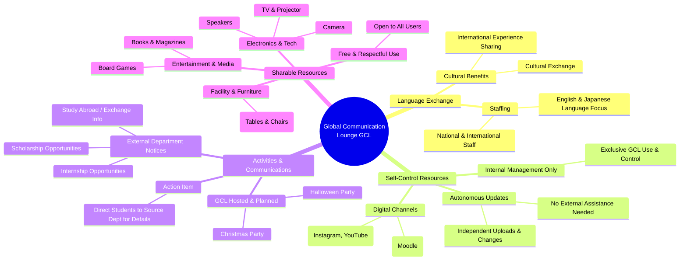

## What is GCL?
The GCL is a space dedicated for students to interact with international people and learn about different cultures. Here, international students receive support and instructions about how to better adapt to Japan and Japanese students can better prepare for their events outside the country. Through multi-national and multi-ethnical group activities, we help in preparing Kyutech students for a globalized world.

GCLという空間は学生が国際的な人々と交流し、異文化について学ぶための専用スペースです。 ここで留学生は日本での生活に適応する方法についてのサポートやアドバイスを受け、日本人学生はGCLで国際交流をする事で国外でのイベントに参加する際などの準備などに役立てる事が出来ます。 多国籍、多民族の中での交流を通じて、本学学生がグローバル化した世界に備える手助けをします。

[Reference](https://sites.google.com/view/gclkyutech/about-us)
## What can you do at GCL?
- Participate in  Events (That range from presentations to cooking parties)
- Practice a Second Language with English Speakers (There are many international students from varied countries)
- Play games, watch movie, talk something fun,  take a break from classes and more
- Consult about how to better adapt to Iizuka and what do do in the surrounding area

- イベントへの参加（カルチャーイベントからお祭りまで）
- 留学生との交流で第二言語(  英語、中国語、韓国語、等々）を練習する（さまざまな国からの留学生がたくさんいます）
- ゲームをしたり、映画を観たり、話したりまたは授業の合間に息抜きをしたり何でも自由に楽しんでください。
- 飯塚市に馴染む方法や周辺での便利な場所など何でも相談してください

## GCL Partners:
- English Language Teachers at Kyutech
- Cheers Club – Student Activities

