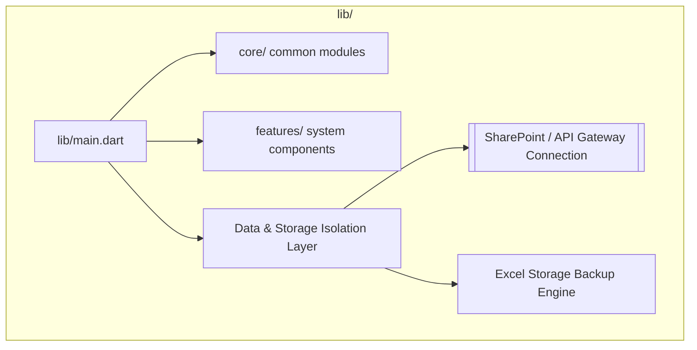
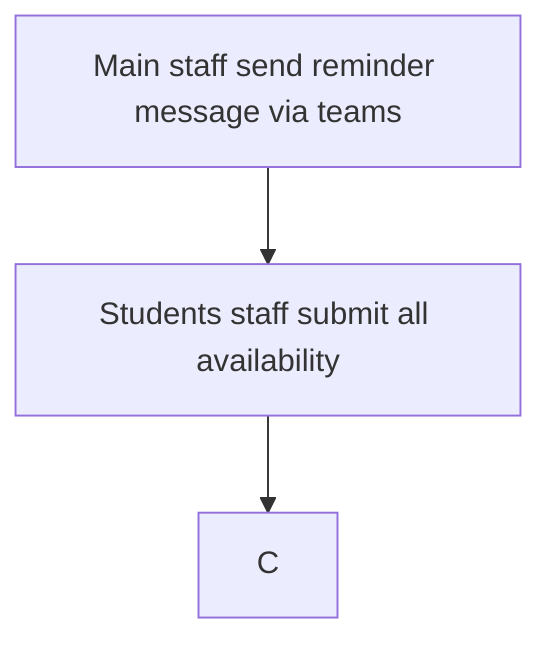
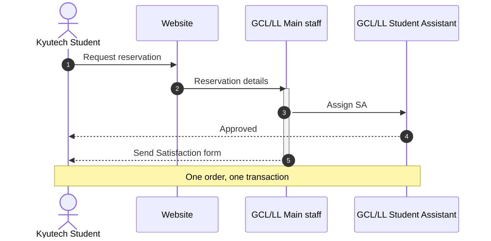
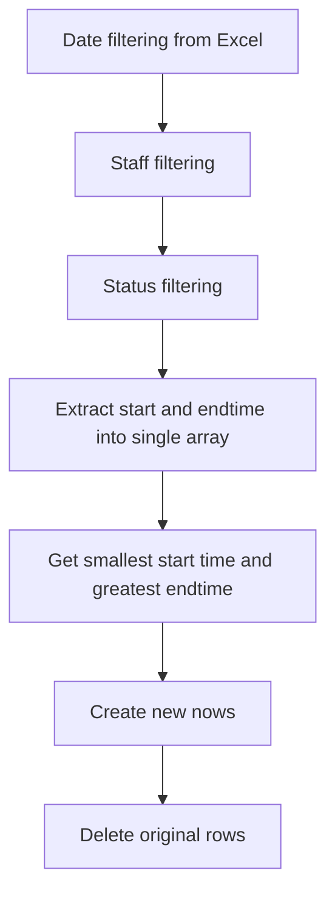
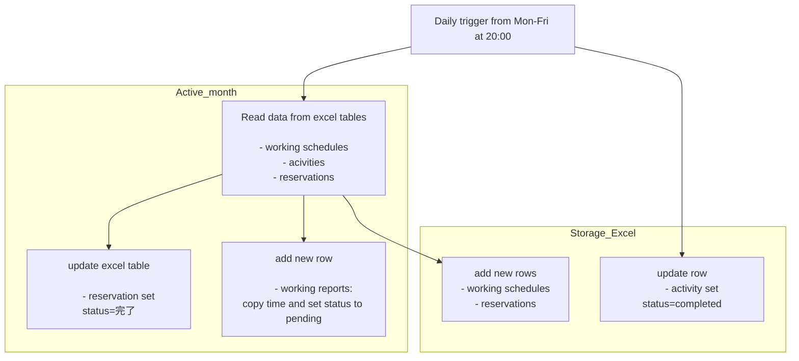
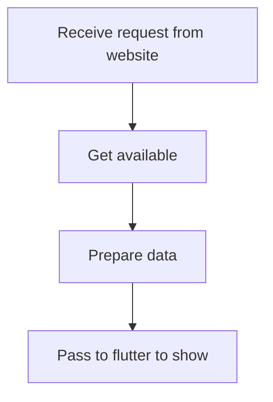

# 🗺️ System Blueprint (Auto-Generated from Flutter Codebase)

This documentation maps out your structural layers directly from your local codebase configuration.

---

## 1. Modular Application Architecture Map
This layout visually separates your presentation layer from the core storage logic.

---
## Next month availability submission
Via power apps

## Reservation
Reservation website: https://gcl-personnel-kohl.vercel.app

# Developer 
## Grouping working schedules
Data table: [Working Schedules](/documentation/data_tables.md#working-schedules)

## Working report prefill
Data tables:
- [working schedules](./data_tables.md#working-schedules)
- [working reports](./data_tables.md#working-report)
- [reservations](./data_tables.md#reservations)
- [activities](./data_tables.md#activities)

## passing information from excel to public website
website
Data tables:
- [reservation availability](./data_tables.md#reservation-availability)

