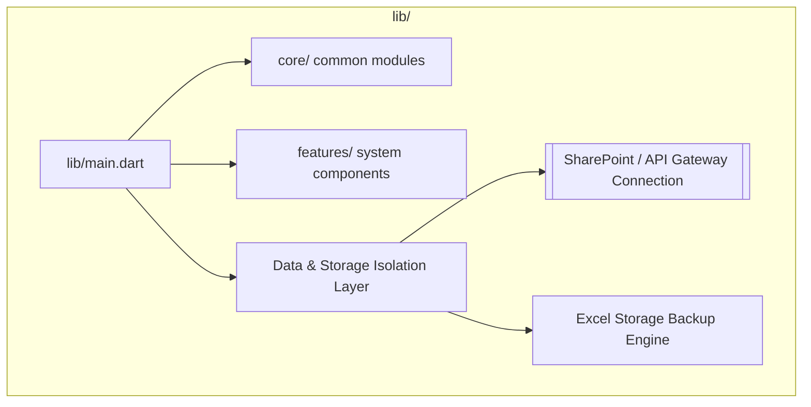
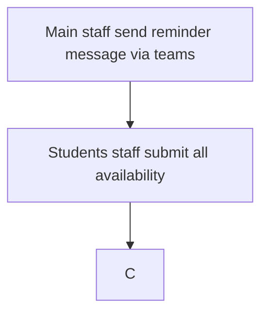
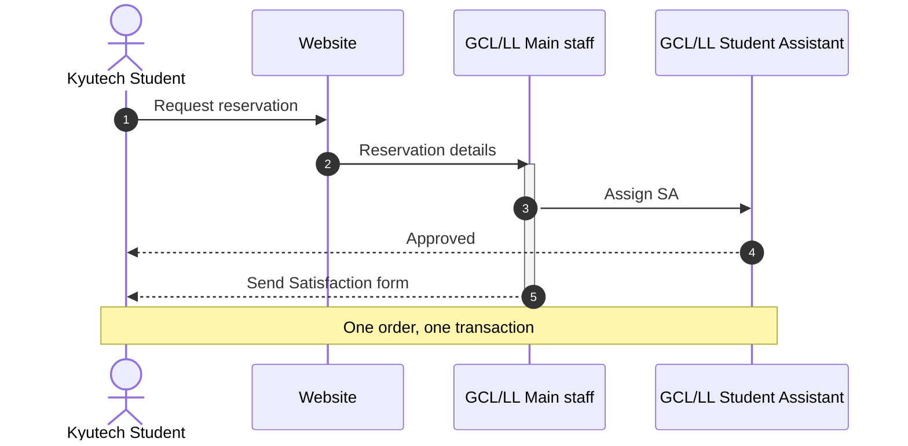
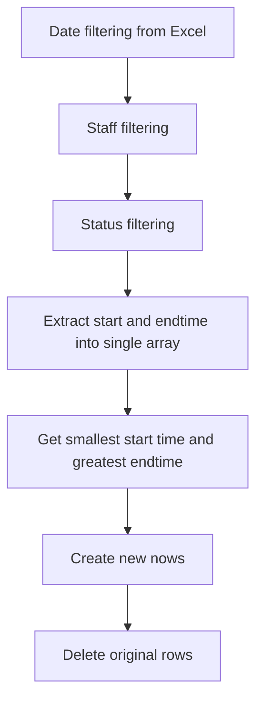
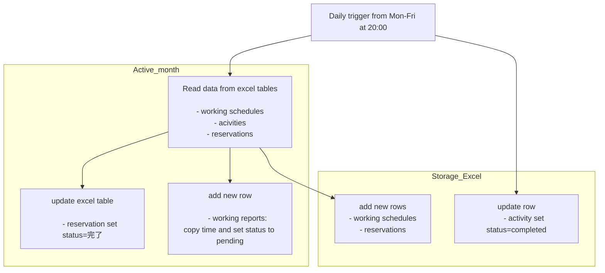
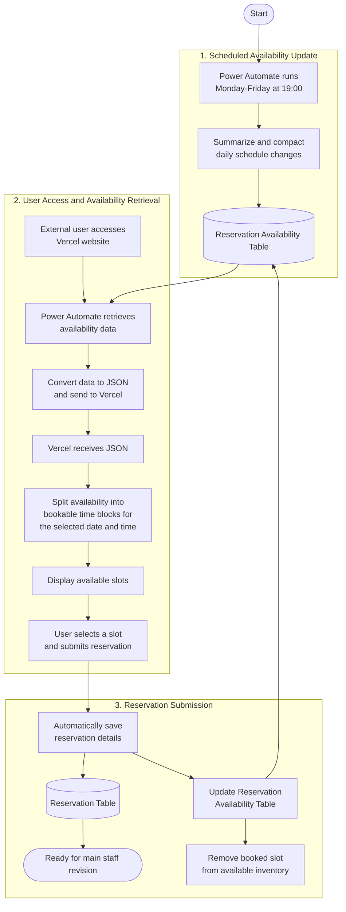

# 🗺️ System Blueprint (Auto-Generated from Flutter Codebase)

This documentation maps out your structural layers directly from your local codebase configuration.

---

## 1. Modular Application Architecture Map
This layout visually separates your presentation layer from the core storage logic.

---
## Next month availability submission
Via power apps

## Reservation
Reservation website: https://gcl-personnel-kohl.vercel.app

# Developer 
## Grouping working schedules
Data table: [Working Schedules](/documentation/data_tables.md#working-schedules)

## Working report prefill
Data tables:
- [working schedules](./data_tables.md#working-schedules)
- [working reports](./data_tables.md#working-report)
- [reservations](./data_tables.md#reservations)
- [activities](./data_tables.md#activities)

## passing information from excel to public website
Reservation website: https://gcl-personnel-kohl.vercel.app

Data tables:
- [reservation availability](./data_tables.md#reservation-availability)
- [working schedules](./data_tables.md#working-schedules)
- [reservations](./data_tables.md#reservations)

## Reservation Availability and Booking Workflow

The reservation process begins with a scheduled Power Automate flow that runs Monday through Friday at 19:00. The flow summarizes and compacts changes made to the daily staff schedules, then updates the Reservation Availability Table to keep the available time-slot data organized and ready for retrieval. When an external user accesses the Vercel website, Power Automate retrieves the reservation availability data, converts it into JSON, and sends it to Vercel. The website processes the received data and splits availability into bookable time blocks for the requested date and time, allowing the user to select a desired slot.

When the user submits a reservation, the reservation details are automatically saved to the Reservation Table, and the Reservation Availability Table is updated to remove the booked time slot from available inventory. This ensures that subsequent availability requests reflect the latest reservation data and reduces the risk of duplicate bookings. Developers should ensure that reservation records and availability updates remain consistent, particularly when multiple users attempt to reserve the same time slot concurrently.

